 
<!--
  RolandCipher — Data · Technology · Problem Solving
  GitHub: https://github.com/rolandcipher
-->

  

  <strong>I identify problems, analyze possibilities, and build practical solutions through data and technology.</strong>

  
  

  

  
    <a href="#01--about">About</a> ·
    <a href="#02--featured-projects">Projects</a> ·
    <a href="#03--technical-skills">Skills</a> ·
    <a href="#04--how-i-work">How I Work</a> ·
    <a href="#05--environment">Environment</a> ·
    <a href="#06--connect">Connect</a>
  

---

## 01 — About

I enjoy understanding how things work, identifying where they can be improved, and developing solutions for practical problems.

My background combines more than 20 years of experience working with data and design, including over 15 years using Excel for databases, reporting, sales statistics, financial models and cash-flow analysis in real business environments.

I'm now expanding that experience through Python, SQL, data engineering and software development.

My work focuses on the intersection of **data analysis, business intelligence, financial modeling and technology**.

I don't approach development as an end in itself. I start by understanding a problem, evaluating possible approaches and building a solution that is useful, reproducible and maintainable.

| | |
|:---|:---|
| **Main interests** | Data Analysis · Business Intelligence · Financial Modeling · Data Engineering |
| **Technical focus** | Python · SQL · Pandas · SQLite · Streamlit · Data Pipelines |
| **Also interested in** | Software Development · Automation · Systems · Design |
| **Languages** | Spanish (native) · English (C2, EF SET) |
| **Based in** | Argentina · Open to remote opportunities |

---

## 02 — Featured Projects

My projects explore different problems involving data, business and technology. Each one has its own scope, implementation and documentation.

### 01 · Finance Lab

**Financial Modeling & Scenario Analysis**

[Repository](https://github.com/rolandcipher/finance-lab)

A financial planning and scenario simulation application built with Python and Streamlit.

The project addresses a common business problem: understanding how changes in revenue, costs and expenses affect profitability, cash flow and financial sustainability.

**Key capabilities**
- Monthly profit-and-loss and cash-flow projections.
- Break-even analysis.
- Scenario comparison.
- Sensitivity analysis.
- Risk analysis and financial visualization.
- Exportable reports and data.

**Technologies:** Python · Streamlit · Pandas · Plotly

---

### 02 · Data Pipelines

**Data Integration, Transformation & Quality**

[Repository](https://github.com/rolandcipher/data-pipelines)

A collection of practical data engineering projects focused on building reproducible and reliable data workflows.

The repository explores the challenges of integrating heterogeneous sources, validating records, transforming datasets and preparing structured data for analytical use.

**Projects**
- Sales Data Integration — combining and normalizing multiple data sources.
- API Data Extraction — retrieving and processing structured API data.
- Data Quality & Validation — identifying inconsistencies and preserving traceability.
- Analytical Data Warehouse — organizing data into analytical models.

**Design principles**
- Reproducible execution.
- Data validation and traceability.
- Explicit handling of invalid records.
- Idempotent pipeline operations.
- Automated testing.

**Technologies:** Python · Pandas · SQL · SQLite · DuckDB · pytest

---

### 03 · arlitesql

**Local-First Data Analysis Workbench**

*Under active development — repository coming soon.*

A local-first environment designed to bring SQL, Python, data preparation, visualization and automation into a single analytical workflow.

The project explores a practical problem: data analysis often requires moving between disconnected tools to inspect databases, transform information, run queries, visualize results and prepare reports.

**Implemented capabilities**
- SQLite database exploration and SQL querying.
- Python and Pandas analysis.
- Interactive Plotly visualizations.
- Data profiling and exploratory analysis.
- Query and visualization libraries.
- Export to common data and reporting formats.
- Reproducible SQL/Python pipelines.
- Command-line pipeline execution.

**Planned extensions**
- DuckDB integration for analytical workloads.
- Assisted data cleaning and quality workflows.
- Reversible, documented transformation history.

**Technologies:** Python · Streamlit · SQLite · Pandas · Plotly · YAML

**Project direction:** From raw data to clean, visualized and reproducible analysis.

---

### 04 · Music Player

**Web Application & User Experience**

An online music player developed as an independent software project.

It explores browser-based application development, interface design and the implementation of a practical media experience.

**Focus:** Software Development · Web Interfaces · User Experience

*Repository and demonstration links will be added here.*

---

### Additional Projects

Smaller tools and experiments that complement my main work:

| Project | Focus |
|:---|:---|
| [Data Intelligence](https://github.com/rolandcipher/data-intelligence) | Data cleaning, exploratory analysis and SQL |
| [Business Intelligence Toolkit](https://github.com/rolandcipher/bi-toolkit) | Business metrics and KPI reporting |
| [Inventory & Reconciliation](https://github.com/rolandcipher/inventory-reconciliation) | Inventory control and reconciliation |
| [Data Utilities CLI](https://github.com/rolandcipher/data-utils-cli) | Data validation and command-line tools |
| [Automation & Systems](https://github.com/rolandcipher/automation-systems) | Python, Bash and Linux automation |
| [Core](https://github.com/rolandcipher/core) | Personal portfolio website |

---

## 03 — Technical Skills

### Data Analysis & Business Intelligence

- SQL and relational databases.
- Python and Pandas.
- Data cleaning, transformation and validation.
- Exploratory data analysis.
- Statistical summaries and visualization.
- Financial modeling and scenario analysis.
- KPI design and business reporting.

### Data Engineering

- ETL pipeline development.
- CSV, JSON and API data ingestion.
- SQLite and DuckDB.
- Data quality and validation.
- Reproducible workflows.
- Automated testing.

### Software & Automation

- Python application development.
- Streamlit.
- Command-line tools.
- Bash scripting.
- Git and GitHub.
- HTML, CSS and JavaScript.
- Linux environments.

### Tools & Technologies

  

  

*Technologies are presented according to their use in my projects, not as a claim of equal proficiency in every tool.*

---

## 04 — How I Work

I follow a problem-oriented approach to development.

**01. Understand the problem**

Identify the actual need, constraints and context before choosing a technology.

**02. Analyze the possibilities**

Explore alternatives, evaluate trade-offs and determine what a useful solution should accomplish.

**03. Design and implement**

Translate the proposed approach into a functional application, analytical workflow or automated process.

**04. Test and validate**

Check calculations, transformations and expected behavior rather than assuming that an implementation is correct.

**05. Document and improve**

Make the work understandable, reproducible and open to future improvements.

My goal is not to add complexity for its own sake, but to build solutions that make a process clearer, more reliable or more efficient.

---

## 05 — Environment

I prefer lightweight tools and local environments that provide control over the development and analytical workflow.

| Component | Setup |
|:---|:---|
| Operating system | Debian GNU/Linux |
| Window manager | i3 |
| Programming | Python |
| Data analysis | Pandas · SQL |
| Application development | Streamlit · Web technologies |
| Databases | SQLite |
| Version control | Git · GitHub |
| Documentation & planning | Markdown · Obsidian |

---

## 06 — GitHub Activity

  
  

  

---

## 07 — Connect

I'm interested in opportunities and collaborations involving:

- Data Analysis and Business Intelligence.
- Financial Analysis and Modeling.
- Data Preparation and ETL.
- Automation and analytical software.
- Practical applications of technology to business problems.

**Open to remote opportunities and collaborative projects.**

  

---

  <h3>ROLANDCIPHER</h3>

  Problem Solving · Data · Technology · Systems · Design

    

  © 2026 RolandCipher

