 
<!--
  RolandCipher — Technology, Data & Systems Portfolio
  GitHub: https://github.com/rolandcipher
-->

<!-- ==================== HEADER ==================== -->

  

  I combine analysis, technology, and creativity to solve problems and turn ideas into practical solutions.

  
  

  

  
    <a href="#01--about">About</a> ·
    <a href="#02--projects">Projects</a> ·
    <a href="#03--technology">Technology</a> ·
    <a href="#04--interests">Interests</a> ·
    <a href="#05--environment">Environment</a> ·
    <a href="#06--roadmap">Roadmap</a> ·
    <a href="#07--github-activity">Activity</a> ·
    <a href="#08--connect">Connect</a>
  

---

## 01 — About

I'm an independent developer and analytical thinker interested in understanding complex problems and exploring how technology can turn ideas into practical solutions.

My work and learning interests bring together software development, data analysis, financial modeling, and business systems.

I enjoy approaching problems from different perspectives: understanding how a system works, examining the information behind it, identifying relationships between variables, and developing tools that make complex situations easier to understand.

My approach is based on a few principles:

- Understand the problem before choosing the solution.
- Analyze information before drawing conclusions.
- Build practical tools instead of focusing only on theory.
- Connect different disciplines to discover new approaches.
- Value clarity, functionality, and maintainability.
- Learn through experimentation, documentation, and independent projects.
- Treat technology as a means to understand and improve real-world systems.

I'm particularly interested in the relationship between software, analytical methods, financial intelligence, business processes, and automation.

I believe technology becomes more valuable when it helps people understand complex situations, interpret information, and make better decisions.

### Areas of focus

| Domain | Focus |
|:---|:---|
| **Software Development** | Building practical applications, tools, and digital solutions |
| **Data Analysis** | Processing, exploring, interpreting, and visualizing information |
| **Financial Modeling** | Financial projections, simulations, and scenario analysis |
| **Business Intelligence** | Understanding performance through operational and financial data |
| **Automation** | Improving workflows and reducing repetitive processes |
| **Systems Thinking** | Understanding structures, dependencies, and interactions |
| **Applied Technology** | Exploring how technical and analytical methods can address different real-world problems |

---

## 02 — Projects

A growing collection of independent projects, practical applications, and technical experiments.

My objective is to develop solutions that combine analytical thinking, functional design, and technology.

### 01 · Finance Lab

ACTIVE PROJECT · PYTHON · STREAMLIT · FINANCIAL MODELING

An interactive financial simulator designed to explore business performance, financial projections, and alternative economic scenarios.

**Main objectives:**

- Model revenue, costs, expenses, and profitability.
- Analyze cash flow and financial performance.
- Compare alternative financial scenarios.
- Explore break-even points and sensitivity analysis.
- Present financial information through interactive visualizations.
- Transform numerical information into useful insights.

**Technology direction:**

`Python` · `Streamlit` · `Pandas` · `NumPy` · `Plotly`

  
  
  
  

**Status:** Initial development, financial model design, and implementation.

---

### 02 · Data Intelligence

FUTURE PROJECT · DATA ANALYSIS · EXPLORATORY ANALYTICS

A practical environment for exploring datasets, applying analytical techniques, and transforming raw information into interpretable results.

**Planned capabilities:**

- Data cleaning and transformation.
- Exploratory data analysis.
- Statistical summaries.
- Data visualization.
- Trend and pattern identification.
- Comparative analysis.
- Reproducible analytical workflows.

**Technology direction:**

`Python` · `Pandas` · `NumPy` · `Matplotlib` · `Plotly` · `SQL`

---

### 03 · Business Intelligence Toolkit

FUTURE PROJECT · BUSINESS ANALYTICS · DECISION SUPPORT

A collection of analytical tools focused on understanding business performance through operational, commercial, and financial information.

**Planned capabilities:**

- KPI monitoring.
- Revenue and cost analysis.
- Profitability indicators.
- Cash flow monitoring.
- Operational performance analysis.
- Management reporting.
- Data-driven decision support.

**Technology direction:**

`Python` · `SQL` · `Streamlit` · `Data Visualization`

---

### 04 · Automation & Systems

ONGOING EXPLORATION · LINUX · AUTOMATION

Practical experiments involving Linux environments, scripting, workflow optimization, and system configuration.

**Areas of exploration:**

- Linux administration.
- Shell scripting.
- Workflow automation.
- API integrations.
- System configuration.
- Networking fundamentals.
- Technical troubleshooting.

**Technology direction:**

`Debian` · `Linux` · `Bash` · `Python` · `Git` · `APIs`

---

*Projects will evolve as new skills are acquired and new problems are explored.*

---

## 03 — Technology

My technical ecosystem is evolving through independent learning, practical experimentation, and project development.

I distinguish between the tools I currently use, those involved in active projects, and technologies I intend to explore.

### Current environment

  

### Active project ecosystem

  

### Technologies to explore

  

### Technology domains

| Domain | Technologies and concepts |
|:---|:---|
| **Programming** | Python, JavaScript, TypeScript |
| **Web Development** | HTML, CSS, React |
| **Data Analysis** | Pandas, NumPy, statistics |
| **Visualization** | Matplotlib, Plotly |
| **Application Development** | Streamlit, FastAPI, Flask |
| **Databases** | SQLite, SQL, PostgreSQL, MySQL |
| **Operating Systems** | Linux, Debian |
| **Automation** | Bash, Python scripting |
| **Version Control** | Git, GitHub |
| **Infrastructure** | Docker, APIs, deployment |
| **Artificial Intelligence** | AI-assisted development and API integrations |

*This section combines my current environment, technologies used in active projects, and areas I intend to explore. It does not imply equal proficiency across all listed technologies.*

---

## 04 — Technical Interests

### Analytical Thinking & Data

- Data interpretation.
- Exploratory data analysis.
- Statistical reasoning.
- Data visualization.
- Decision-support tools.
- Analytical workflows.
- Evidence-based reasoning.

### Financial Technology & Business Intelligence

- Financial modeling.
- Cash flow analysis.
- Profitability analysis.
- Financial projections.
- Scenario simulation.
- Business performance indicators.
- Operational and commercial analytics.

### Software Development

- Application architecture.
- Modular development.
- Backend and frontend integration.
- Database design.
- API development.
- Software quality and testing.
- Practical user-oriented solutions.

### Systems & Infrastructure

- Linux environments.
- System administration.
- Automation and scripting.
- Networking fundamentals.
- Security principles.
- Deployment and troubleshooting.
- Open-source ecosystems.

### Artificial Intelligence

- AI-assisted development.
- API-based integrations.
- Intelligent automation.
- Data-driven applications.
- Practical AI use cases.
- Human-centered applications of AI.

---

## 05 — Development Environment

I prefer lightweight environments and tools that offer control over the workflow.

| Component | Environment |
|:---|:---|
| Operating System | Debian GNU/Linux |
| Window Manager | i3 |
| Knowledge Management | Obsidian |
| Version Control | Git / GitHub |
| Application Development | Python / Streamlit |
| Documentation | Markdown |
| Organization | Tasks, Kanban, Dataview |

I value open-source software, structured workflows, reproducibility, and the ability to understand and customize the tools I use.

My development environment is also a space for experimentation, documentation, and continuous improvement.

---

## 06 — Learning Roadmap

My roadmap is broader than my current technical environment. The objective is to build a solid foundation through practical projects, independent learning, and progressively more complex challenges.

| Track | Technologies / Concepts | Direction |
|:---|:---|:---|
| **Programming** | Python, JavaScript, TypeScript | Application development |
| **Data Analysis** | Pandas, NumPy, statistics | Data interpretation |
| **Visualization** | Plotly, Matplotlib | Interactive reporting |
| **Databases** | SQL, PostgreSQL | Data architecture |
| **Backend** | FastAPI, Flask | APIs and services |
| **Frontend** | HTML, CSS, React | User interfaces |
| **Automation** | Bash, Python, APIs | Workflow engineering |
| **Infrastructure** | Linux, Docker | Deployment and operations |
| **Software Quality** | Testing, debugging, CI/CD | Reliability |
| **Security** | Networking, application security | Defensive engineering |
| **Artificial Intelligence** | AI APIs and integrations | Intelligent applications |

### Long-term direction

**Software Development + Data Analysis + Systems Thinking + Scientific and Applied Research**

My long-term goal is to continue expanding the fields in which I can apply technological and analytical knowledge.

I am particularly interested in how software development, data analysis, and systems thinking can contribute to understanding complex problems across different domains.

As my education and experience evolve, I intend to explore new areas of application, progressively broadening the relationship between technology, scientific knowledge, and research.

---

## 07 — GitHub Activity

  
  

  

  

---

## 08 — Connect

I'm interested in connecting with people working across software development, data analysis, financial technology, business intelligence, automation, and applied technology.

I value knowledge sharing, interdisciplinary thinking, collaborative projects, and the exchange of ideas.

  

<!-- Add professional links when available:
LinkedIn:
Portfolio:
Email:
-->

---

  <h3>ROLANDCIPHER</h3>

  **Engineering ideas into solutions.**

  Analysis · Technology · Systems · Creativity

    

  <em>"The best solutions begin with understanding the problem."</em>

    

  © 2026 RolandCipher · Built with curiosity and continuous learning.

